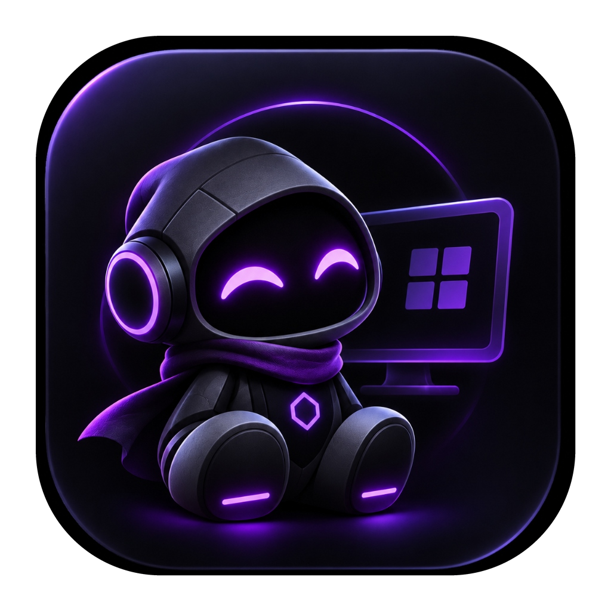
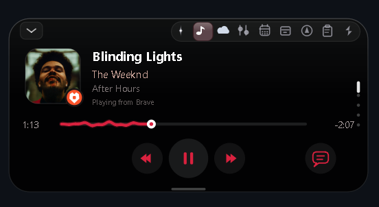
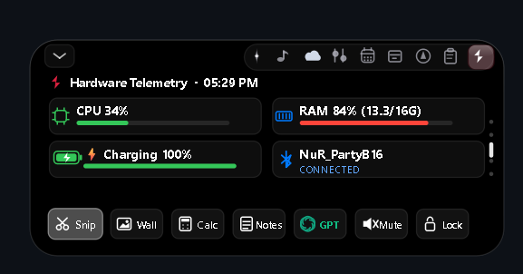

# Desktop Pet & JARVIS AI Companion 🛸🐾

[](https://github.com/Allu555/Jarvis-Pet/actions/workflows/ci.yml)
[](https://microsoft.com/windows)
[](https://python.org)
[](LICENSE)

An ultra-lightweight, high-performance desktop companion for Windows featuring **autonomous pixel pets**, an interactive **Dynamic Origin Island**, and **JARVIS** — an intelligent voice, vision, and system automation agent.

Designed with an ultra-lightweight architecture: **~60 MB RAM**, **< 1% idle CPU**, and a **100% in-memory zero-disk lyrics engine**.

---



---

## ⚡ Highlights & Features

### 🐾 1. Autonomous Desktop Pets
- **21 Animated Retro Pets**: Tanjiro, Spider-Bot, Robot, Gwen, Inosuke, Zenitsu, Nezuko, Goku, and more.
- **16 Autonomous Behaviors & State Machine**:
  - `walk_left` & `walk_right`: Fluid 8-phase articulated walking along screen edges.
  - `work`: Typing and researching on a holographic cyber-tablet.
  - `idea`: Deep thinking followed by an animated eureka lightbulb.
  - `sleep` & `wake`: Resting after inactivity with animated Zzz and natural wake-up.
  - `happy`, `shrug`, `sit`, `jump`, `roar`, `cry`, `blink`, and more.
- **Interactive Controls**: Click to play, double-click for eureka reactions, and right-click for the context menu.
- **Always-on-Top Click-Through Overlay**: Native Windows Desktop Window Manager (`DWM`) integration with hardware composited alpha transparency.

---

### 🏝️ 2. Dynamic Origin Island
Floating interactive top-notch overlay inspired by modern mobile dynamic islands:

<p align="center">
  
</p>

#### 🎛️ Multi-Feature Island Suite

| 🎵 Expanded Music Player & Waveform EQ | 🌤️ Live Weather & Clock HUD |
| :---: | :---: |
|  |  |
| **⚙️ Control Center & Quick Toggles** | **📁 Smart Shelf (File & Tool Stash)** |
|  |  |

<p align="center">
  <b>⚡ Live Hardware Telemetry & Quick Tools</b><br>
  
</p>

- **Real-Time Media Detection**: Windows SMTC integration for Spotify, YouTube, and media players.
- **Live WASAPI Audio Visualizer**: 60 FPS real-time audio loopback frequency spectrum with adaptive theme colors.
- **100% In-Memory Karaoke Lyrics Engine**: Real-time synchronized lyrics via LRCLIB with zero disk writes, keeping the repository clean and lightweight.
- **Windows Notification Hub**: Native WinRT `UserNotificationListener` integration intercepting live toast alerts (WhatsApp, Discord, Telegram, Google Calendar, Outlook) with animated pill expansions in the Island top-notch, glowing brand accents, and 1-click Quick Open `[ ↗ ]` & Dismiss `[ ✕ ]` actions.
- **Phone Link Wireless Trackpad & Presentation Remote**: Multi-touch smartphone trackpad with cursor tracking, tap-to-click, 2-finger scroll, tactile click pads, and slide presentation clicker (Next `▶`, Prev `◀`, Start `F5`, Blackout `B`, Exit `Esc`).
- **Control Center & HUD**: Live battery percentage, weather updates, pomodoro focus timer, and quick tool shortcuts.

---

### 🤖 3. JARVIS Voice & Vision Agent

<p align="center">
  
</p>

- **Agent Brain**: Powered by NVIDIA NIM (`nvidia/nemotron-3.5-bolt-e4b`) for low-latency tool orchestration and reasoning.
- **Vision Grounding**: Set-of-Marks visual perception (`nvidia/nemotron-3.5-super-vl-120b-a12b`) for precise UI element localization.
- **Direct App Control**: Native window management (`user32.dll`), full-screen window maximization, PWA launch, and intelligent Spotify search & playback.
- **Hands-Free Speech Engine**:
  - **Wake Word**: `openWakeWord` (`hey_jarvis_v0.1` ONNX) operating at < 0.5% CPU.
  - **Speech-to-Text (STT)**: `faster-whisper` (`small.en`) with custom prompt biasing.
  - **Speech Synthesis (TTS)**: Microsoft Neural voice streaming (`edge-tts`) with offline Windows SAPI5 fallback.

---

## 📊 System Telemetry & Model Architecture

The entire suite is engineered for zero system lag and minimal resource consumption:


| Subsystem | Model / Technology | Execution | Memory Footprint |
| :--- | :--- | :--- | :--- |
| **Agent Brain** | `nvidia/nemotron-3.5-bolt-e4b` | Cloud API (NVIDIA NIM) | **0 MB** |
| **Vision Grounding** | `nvidia/nemotron-3.5-super-vl-120b-a12b` | Cloud API (NVIDIA NIM) | **0 MB** |
| **Local Screen OCR** | `Windows.Media.Ocr` (WinRT) | Hardware Accelerated | **~20 MB** (on-demand) |
| **Speech-to-Text (STT)**| `faster-whisper` (`small.en`) | Local CTranslate2 | **~180 - 320 MB** (on-demand) |
| **Wake Word Engine** | `openWakeWord` (`hey_jarvis_v0.1` ONNX) | Local ONNX Runtime | **~22 MB** (< 0.5% CPU) |
| **Speech Synthesis (TTS)**| `edge-tts` (`en-GB-RyanNeural`) | Cloud WebSockets | **0 MB** |
| **Karaoke Lyrics** | `LRCLIB` Synced Engine | In-Memory LRU Cache | **< 0.1 MB** (0 Disk Files) |
| **GUI & Overlay** | `PySide6` (Qt 6) | DWM Hardware Composited | **~42 MB** |

---

## 🚀 Getting Started

### Prerequisites
- Windows 10 or Windows 11 (64-bit)
- Python 3.10 or 3.11

### Installation

1. **Clone the repository**:
   ```bash
   git clone https://github.com/Allu555/Jarvis-Pet.git
   cd Jarvis-Pet
   ```

2. **Install dependencies**:
   ```bash
   pip install -r requirements.txt
   ```

3. **Configure API Keys (Optional for Cloud Agent)**:
   Create a `.env` file in the project root:
   ```env
   NVIDIA_API_KEY=your_nvidia_nim_api_key
   ```

4. **Launch Application**:
   ```bash
   python main.py
   ```
   Or double-click `start_everything.vbs` to start silently in the background without any command prompt windows.

---

## 🎮 Controls & Shortcuts

| Action | Control |
| :--- | :--- |
| **Pet Reaction** | Left-Click on pet |
| **Eureka / Hologram Work** | Double-Click on pet |
| **Context Menu & Pet Switcher**| Right-Click on pet |
| **Expand Dynamic Island** | Hover or click top notch |
| **Phone Link Remote** | Click Phone icon on Island shelf |
| **Settings Dialog** | Right-click pet → Settings ⚙️ |

---

## 👤 Author & Creator

<div align="center">
  <a href="https://github.com/Allu555">
    <br /><br />
    <b>Alameen Najeeb (@Allu555)</b><br />
    <sub>Creator & Lead Architect</sub>
  </a>
</div>

---

## 🛡️ License

This project is licensed under the MIT License.
